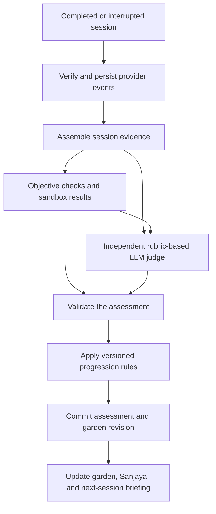
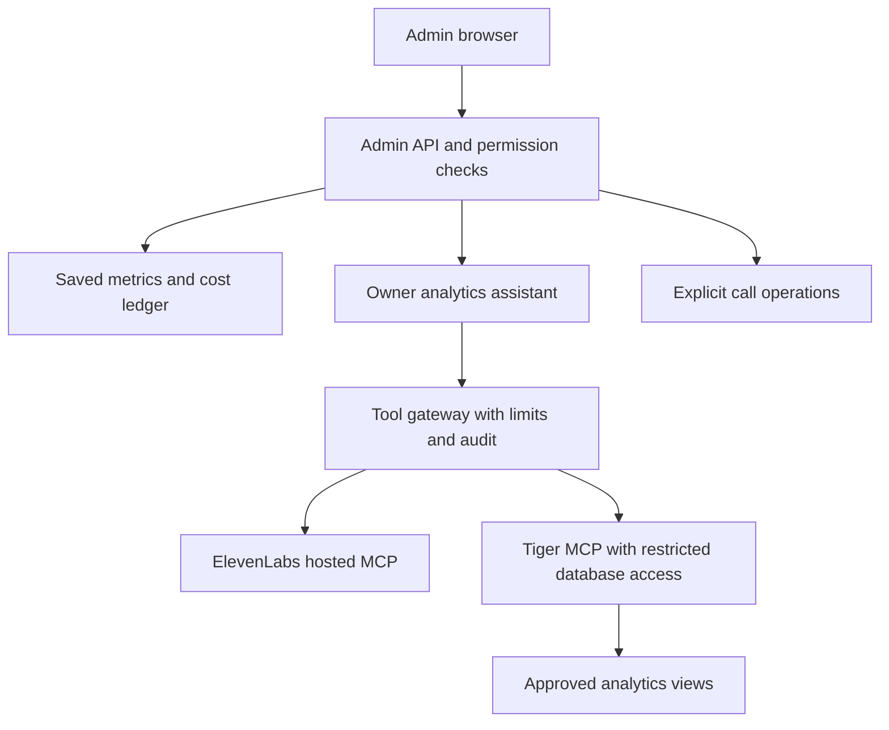

**Skill Garden — architecture discussion brief**

Updated October 4, 2026. Status: proposed architecture and requirements; application screens and provider integrations have not been implemented or connected. Confirmed decisions and recommendations are distinguished below.

**The confirmed pilot is for Comp Sci students and job seekers in the United States.** The operating-cost target is US$5–10 per active user per month, including AI and allocated infrastructure. Bhima must make actual scheduled phone calls. Administrators need a separate login and dashboard, an immediate developer test-call button, usage and user management, and AI-assisted owner analytics using ElevenLabs MCP and Tiger MCP. Peak concurrency and initial active-user count remain unspecified.

The wider product includes technical and soft-skill coaching, with later ML and Mechanical/Robotics curricula. Character names below are proposals. The central product rule is that each garden growth event must cite demonstrated evidence.

| Experience | Proposed identity | Inputs and outputs |
| --- | --- | --- |
| Concept examination | Drona | Uploaded study material; voice questions, teaching, cross-questioning, evidence |
| Technical interview | Arjuna | Resume and/or JD; code, reasoning, hints, sandbox results |
| HR interview | Vidura | Role context and behavioral questions; communication feedback, optional presentation observations |
| Accountability | Bhima | Explicit commitments and progress; scheduled US phone calls and next actions |
| Morning self-talk | Krishna | Preferences and optional reflections; energetic or calm preparation |
| Learner analytics | Sanjaya | Assessed evidence; garden changes, explanations, next practice |
| Owner administration | Owner Console | Operational data, users, spending, calls, and AI-assisted analysis |

**Use one shared backend with distinct modules and separate worker processes.** Proposed stack: Next.js/TypeScript web interfaces, React Three Fiber for garden and avatars, Python/FastAPI backend, Tiger Cloud PostgreSQL, a durable job queue and scheduler, object storage, and isolated code execution. Redis may support temporary coordination and caching. Choose the hosting and queue provider after the initial cohort and concurrency target are known.

The learner browser connects to ElevenLabs using backend-issued session credentials. The application backend owns identity, authorization, session records, curriculum, assessment rules, and spending limits. Voice-agent tools call narrow authenticated backend endpoints. Document processing, judging, memory updates, provider reconciliation, and scheduled calls run as durable jobs.

Persist domain state in PostgreSQL; keep original documents and recordings in object storage. Use vector search for document and memory retrieval. Use time-series tables and rollups where event volume justifies them. The prerequisite graph can initially be represented by ordinary relational tables.

**Keep memory attributable and specific to its purpose.**

| Layer | Stored information | Important distinction |
| --- | --- | --- |
| Profile | Major, goals, language, experience, preferences | User claims do not establish mastery |
| Knowledge | Parsed material, source pages, document versions | Uploaded text is context, never trusted instructions |
| Session | Questions, answers, code, hints, execution results | Live observations are provisional |
| Skills | Assessed dimensions, misconceptions, review dates | Assessment and progression are versioned |
| Commitments | Promises, deadlines, reported or verified completion | Self-report and observed completion remain distinct |
| Private reflections | User-selected morning-session memories | Sharing across characters is configurable |

Build a bounded session briefing from relevant memories rather than passing every transcript into each call. A memory includes source, timestamp, status, and any applicable expiration. Users can correct remembered facts. Tentative misconceptions require subsequent evidence. Corrections supersede prior records explicitly.

Onboarding creates unassessed concept saplings from a versioned curriculum. Track explanation, application, transfer, assistance, and later retention. Soft-skill rubrics score specific communication behaviors. Camera observations must not infer honesty, personality, mental state, or technical competence. Habit completion has its own progression and does not establish technical mastery.

**The offline Skill Garden pipeline combines AI assessment with deterministic updates.** Here, offline means asynchronous background processing outside the live conversation; the workers can still call hosted AI services. Use ElevenLabs' native workflows for adaptive questioning and conversation phases. Use durable backend jobs for document ingestion and assessment, objective checkers where applicable, an independent LLM judge for open-ended answers, and versioned backend rules for persistent garden changes. The pilot does not require an additional autonomous-agent framework.

**Maintain separate pipelines for learning material and learner state.** Documents provide reference material, the curriculum defines assessable concepts and relationships, and session evidence describes what a learner has demonstrated. A completed examination updates learner state. Raw learner answers must not automatically become authoritative teaching material in the knowledge base.

The knowledge-base update pipeline runs when material is uploaded or replaced:

1. Store the original document, owner, content hash, and version.
2. Extract and inspect text, preserving page references and flagging extraction problems.
3. Use AI to propose concept mappings; validate them against the concept catalog to avoid duplicate plants or incorrect merges.
4. Store searchable chunks and publish approved material to ElevenLabs knowledge storage.
5. Activate the new version for authorized sessions only after indexing succeeds. Keep the previous working version available on failure, and retain the source version used by each examination and its judge.

Documents and sessions remain isolated between users. Native per-conversation knowledge-base overrides exist, but client-editable overrides are not an authorization boundary. Validate isolation in the first integration spike; use isolated agent configurations or backend-authorized retrieval if private document selection cannot be securely constrained. Parsing or uploading a document does not award mastery. Resume content changes the interview plan but remains self-reported until assessed.

**The post-session assessment pipeline produces evidence-backed garden changes.** Live observations support interviewer adaptation and provisional UI feedback. Permanent changes follow this workflow:

Verify the ElevenLabs post-call webhook, durably save it, and acknowledge promptly before grading. Reconcile the provider transcript with question IDs, answers, code snapshots, execution results, assistance, and source/rubric versions. Recoverable interrupted sessions can produce partial evidence; unavailable evidence remains pending or unassessable.

| Responsibility | Implementation |
| --- | --- |
| Objective correctness | Deterministic answer checkers and code tests where appropriate |
| Explanations and behavioral answers | LLM assessment against a concept-specific or communication rubric |
| Assessment validation | Check schema, ownership, evidence references, concept IDs, and recorded assistance |
| Progression and persistence | Deterministic rules, transactions, deduplication, and revision checks |
| Next examination | Relevant accepted assessments and unresolved gaps supplied to the interviewer |

Execute user code outside the application host with network, time, memory, and CPU restrictions. Passing tests establishes behavior on tested cases; it does not alone establish general understanding. The judge returns concept, dimension, outcome, evidence references, rationale, uncertainty, and rubric/model versions. It does not directly set plant size or issue database writes. Valid structure and references do not guarantee a correct judgment: calibrate on human-reviewed examples and support uncertain outcomes and disputed assessments. ElevenLabs' built-in evaluation can supplement operational checks and preliminary assessment; our backend owns cross-session progression.

**Growth rules distinguish independent evidence from assisted practice.** A correct explanation contributes to explanation evidence; solving after a targeted hint records assisted application. Independent success on distinct problem families can establish application and transfer. A later independent check can establish retention. Repeated versions of the same answer are not independent demonstrations. Ambiguous or contradictory evidence triggers a targeted reassessment. Exact attempt counts and difficulty thresholds remain configurable proposals to calibrate during the pilot.

For example, a correct binary-search explanation followed by a boundary-case failure and a hinted fix records demonstrated explanation and assisted application. The next examiner tests a fresh boundary-condition problem. Habit completion never substitutes for technical evidence. Historical earned milestones remain visible while current readiness and review status can change; incorrect awards can be corrected with an explanation.

Commit the accepted assessment, garden revision, and outgoing update event together. Preserve evidence and revisions. Missing webhooks are reconciled through provider APIs; failed jobs are retryable. Duplicate events cannot award growth twice. Concurrent sessions use transaction locking or revision checks so stale results cannot silently overwrite newer evidence. Replaying a saved assessment under the same rule version produces the same garden result; rerunning the LLM creates a new assessment revision rather than silently replacing the old judgment.

To fit the operating budget, start with one main judge pass per session covering the assessed concepts, splitting longer sessions into bounded sections where necessary. Reserve additional judge calls for ambiguity, disagreement, and quality sampling. Reprocess documents when their content changes rather than re-indexing after every conversation. Record worker status, retries, assessment versions, and model usage for the owner dashboard.

**The admin application gets its own login entry and authorization boundary.** Proposed deployment: an admin application on an admin subdomain in the same monorepo, sharing typed contracts with the learner application. A separate hostname alone does not provide isolation: every admin API checks the authenticated session, admin audience, and server-assigned permissions.

Reuse a managed identity provider with an invite-only admin application and MFA. No public admin signup, browser-selected role, shared developer password, or learner-to-admin promotion through profile edits. Bootstrap the first owner through deployment configuration. Use host-scoped cookies and CSRF protection where applicable. Provider credentials remain on the server.

| Role | Proposed access |
| --- | --- |
| Owner | Financial and operational analytics, administrator invitations, budgets, settings |
| Operations admin | User support, schedules, call monitoring, authorized operational actions |
| Analyst | Aggregate analytics and read-only owner assistant |
| Developer/tester | Approved test destinations, test agent versions, integration diagnostics |

Permissions are explicit capabilities; a user can hold more than one role. Viewing raw transcripts or recordings is a separate capability from viewing usage. Every admin mutation records actor, action, target, request ID, time, and relevant before/after state. Analytics views minimize personal data.

**The owner dashboard has six main destinations.**

| Page | Contents |
| --- | --- |
| Overview | Active users, completed sessions, spending, projected month-end spend, failures, data freshness |
| Users | Search, selected user history, garden state, quotas, call enrollment, consent status |
| Usage and costs | Voice duration, billed units, model tokens where available, cost by user/component/provider/model |
| Calls | Upcoming schedules, queue, active and completed calls, failures, developer Call now |
| Quality and operations | Judge backlog, assessment failures, webhook lag, latency, human-review disagreements |
| Ask the owner assistant | Questions answered with underlying metrics, filters, date range, and links to evidence |

Learner analytics and owner analytics have different permissions and presentation. The owner console prioritizes readable tables and charts. The learner garden and avatars carry the heavier 3D experience.

**Scheduled calls and Call now use the same call-dispatch workflow.**

Store verified destination, IANA timezone, local preferred time, selected days, current enrollment, tone, maximum duration, and consent version. A durable scheduler creates an occurrence with a unique key based on schedule and occurrence; store the intended local date as well as UTC execution time. Define daylight-saving behavior explicitly. A deployment restart or schedule edit must not create a duplicate occurrence.

Before dispatch, atomically reserve the appropriate budget and a call slot. Recheck enrollment, destination, quiet-hours rules, current consent, due time, and any cancellation. Respect both provider call-start rate limits and concurrent-session limits. Delay only within the chosen calling window; otherwise mark the occurrence missed and surface it.

Initiate the call through ElevenLabs' native Twilio outbound API, then retain both ElevenLabs conversation ID and Twilio Call SID when returned. Track provider events or reconcile status through supported APIs. A timeout after dispatch creates an unknown state that must be reconciled before another call is attempted. Do not blindly retry a request that may already have placed the call.

Possible outcomes include queued, dispatching, ringing, connected, completed, busy, unanswered, failed, cancelled, and unknown pending reconciliation. Transitions tolerate duplicate and delayed events. The proposal starts with no automatic redial after an unanswered daily call. Intentional retries become separate, linked attempts.

Call now is an explicit admin action against an approved, verified test destination. Its form selects the agent version, test profile, and a bounded duration, shows the destination and cost estimate, and submits one idempotent request. Repeated clicks do not dial again. Test calls consume a separate developer budget and produce test-tagged records; they do not change a real learner's garden or consume the learner's daily scheduled occurrence. A later deliberate test remains possible with a new request ID and cooldown.

The call action remains separate from the analytics assistant's read-only tools. Scheduling a call inside this product is a backend responsibility; no Codex automation or real call has been created by this architecture task.

**Owner AI analytics uses MCP behind a backend gateway.**

Use ElevenLabs' hosted MCP for documented agent and conversation inspection and supported cost-estimation tools. The hosted connector uses OAuth. The backend stores the integration connection and permits only approved read operations for analytics. Do not assume the MCP exposes a complete billing or token-history API: inventory its actual tools during implementation and use direct APIs for missing data.

Use the account-connected Tiger MCP supplied with Tiger CLI for authorized database access, hosted as a controlled backend process/sidecar where necessary. Confirm transport and unattended authentication for the chosen deployment. A documentation-search MCP alone cannot query application data. Configure read-only access, a dedicated database role, and grants on approved analytics views only. Do not expose database credentials or resource-management tools to the model or browser. Restrict schema access, query time, rows, output size, and concurrent queries. Read-only SQL can still be expensive and can disclose whatever it is allowed to read.

The gateway authenticates every owner request, selects permitted tools, enforces query/cost limits, and logs tool execution. User documents, transcripts, and tool results are data rather than instructions. A disconnected provider produces an explicit partial result. Answers identify date range, metric definition, filters, data freshness, and whether amounts are estimated, provider-reported, or reconciled. Numerical answers come from query results; causal explanations are labeled as hypotheses unless supported by a suitable experiment.

Example questions: Which component costs the most per completed session? Which users are projected to exceed their budget? Did the last agent version increase retries? Which topics produce repeated assessment disagreement? Is scheduled calling associated with improved return rates? The last question is observational unless an experiment establishes causality.

**All spending feeds an attributable usage ledger.** Collect application-owned LLM usage directly from responses or traces. Ingest ElevenLabs conversation charging metadata and available token telemetry. Reconcile carrier charges through Twilio usage records, since call duration and call-resource prices do not necessarily represent the full bill. Periodic reconciliation supplements webhooks.

| Record | Key fields |
| --- | --- |
| Usage event | Event ID, user/session/component, provider, model, environment, call/job/request ID, timestamp |
| Measured units | Connected seconds, billable units, input/output/cache token fields where reported, sandbox time, storage usage |
| Cost entry | Native amount/unit/currency, normalized USD, pricing version, source, estimated/provider-reported/reconciled status |
| Budget reservation | User or operational budget, reserved amount, expiry, linked session/call, settled amount |
| Shared allocation | Billing period, infrastructure category, allocation rule and denominator |

Unknown token fields remain null with a coverage indicator. They are not zero and are not inferred from dollar charges. Normalize model usage according to provider semantics so cached or reasoning-token subsets are not added twice. Preserve native provider units rather than treating every field named cost as USD.

Replace an estimated entry with its reconciled representation or link an explicit adjustment; never add both as separate charges for the same usage. Avoid adding included-plan minutes at a retail unit rate on top of the full subscription charge when reporting actual expenditure. Show modeled marginal cost separately from actual invoice allocation. Development calls and owner-assistant queries have their own cost centers and are included explicitly when computing fully allocated product costs.

Define the active-user denominator visibly and version it. Show total fixed operating cost even when there are zero active users; per-user allocated cost is unavailable in that case. Budget reservations prevent two simultaneous sessions from each spending the same remaining allowance. Enforce maximum duration through the provider/application, with warning and graceful wrap-up, rather than relying only on the prompt. Late provider charges and rounding require headroom; a spending cap is a controlled estimate until reconciled.

**The proposed US pilot allowance needs to target the upper end of the confirmed budget.** Published rates checked October 4, 2026: ElevenLabs additional voice minutes are $0.08, with LLM usage separate. Twilio lists standard US/Canada outbound calling at $0.0140/minute and Media Streams at $0.0044/minute. Destination-specific exceptions, billing increments, taxes, numbers, optional features, and actual integration charges must be reflected in reconciliation. This is a transport model, not a quote or an all-in guarantee.

| Illustrative monthly use | Transport model |
| --- | --- |
| 30 completed calls of exactly one billed minute, including a Media Streams allowance | 30 × ($0.08 + $0.014 + $0.0044) = $2.952 |
| Two 15-minute in-app interviews | 30 × $0.08 = $2.40 |
| Combined | $5.352 before LLMs, grading, infrastructure, and other applicable charges |

A one-minute cap includes greeting and wrap-up, so usability must be tested. Calls that overrun a billing increment cost more. Daily two-minute calls plus these interviews would model approximately $8.304 in transport alone. No silence discount or promotional credit is assumed here. The example uses published marginal rates; actual subscription allocation is a separate ledger calculation.

Recommendation: test brief daily Bhima calls, a shared allowance for interview/concept/morning voice sessions, short model context, asynchronous grading, and optional sampled camera feedback. Daily long conversations across all characters cannot be promised within this budget. Test the economics at realistic cohort sizes: shared infrastructure dominates per-user cost when there are very few users. The final duration and quotas are proposed, not yet user-approved requirements.

**Implementation should begin with the foundations that make learning and operating the pilot measurable.**

1. Establish identity, invite-only admin access, typed domain records, usage ledger, provider adapters, and job infrastructure.
2. Prove US telephony with the approved test-number flow, provider correlation IDs, capped duration, usage reconciliation, and the admin Call now screen.
3. Complete the Drona learning loop: versioned document ingestion, scoped voice session, offline evidence assessment, deterministic progression, garden change, and Sanjaya report. Validate assisted versus independent performance and replay without duplicate growth.
4. Enable opt-in scheduled Bhima calls with timezone handling, cancellation, budget checks, and recovery.
5. Add Arjuna coding and Vidura behavioral interviews on the same evidence system.
6. Add Krishna and optional presentation analysis; refine 3D scenes against device performance.
7. Expose the owner analytics assistant through restricted ElevenLabs/Tiger MCP connections and validated metric definitions. Ordinary admin charts and the ledger ship earlier.

Validate user isolation, forbidden admin requests, duplicate webhooks, queue restarts, interrupted sessions, uncertain outbound-call acceptance, schedule changes, daylight-saving boundaries, budget races, missing token telemetry, billing double-counting, and rejected analytics writes. Calibrate grading on human-reviewed answers, especially confident errors and heavily assisted answers. Load tests must cover voice concurrency, call-start rate, worker backlog, database connections, and 3D performance separately.

Before final sizing, choose the initial active-user count and target simultaneous sessions. Before pilot launch, verify native knowledge-base isolation, available hosted token telemetry, unattended MCP authentication, actual US call charges, and performance under the agreed load. Provider accounts and secrets have not been requested or configured yet.

**Sources checked for this discussion**

- [ElevenLabs hosted MCP](https://elevenlabs.io/docs/eleven-agents/operate/hosted-mcp)
- [ElevenLabs outbound Twilio API](https://elevenlabs.io/docs/api-reference/integrations/twilio/outbound-call)
- [ElevenLabs conversation details](https://elevenlabs.io/docs/eleven-agents/api-reference/conversations/get)
- [ElevenLabs post-call webhooks](https://elevenlabs.io/docs/eleven-agents/workflows/post-call-webhooks)
- [ElevenLabs document management](https://elevenlabs.io/docs/eleven-agents/customization/knowledge-base/manage-documents)
- [ElevenLabs agent workflows](https://elevenlabs.io/docs/eleven-agents/customization/agent-workflows)
- [ElevenLabs success evaluation](https://elevenlabs.io/docs/eleven-agents/customization/agent-analysis/success-evaluation)
- [ElevenLabs per-conversation overrides](https://elevenlabs.io/docs/eleven-agents/customization/personalization/overrides)
- [ElevenLabs agent pricing](https://elevenlabs.io/pricing/agents)
- [Tiger MCP access controls](https://www.tigerdata.com/blog/ai-agent-production-database-access)
- [Tiger CLI/MCP release history](https://www.tigerdata.com/docs/get-started/news/new)
- [TigerData hybrid search](https://www.tigerdata.com/docs/learn/tutorials/hybrid-search)
- [TigerData pricing](https://www.tigerdata.com/pricing)
- [Twilio US pricing](https://www.twilio.com/en-us/voice/pricing/us)
- [Twilio usage reconciliation](https://www.twilio.com/docs/voice/resolve-call-log-usage-discrepancies)
